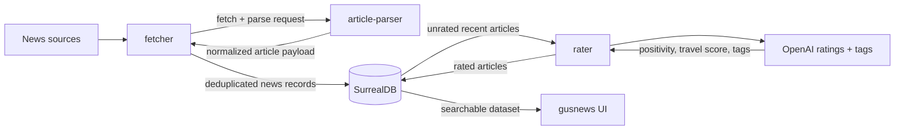

# News Scraper

[](https://github.com/mirsella/news-scraper/actions/workflows/rust.yml)
[](https://github.com/mirsella/news-scraper/actions/workflows/docker.yml)
[](https://www.rust-lang.org/tools/install)
[](https://doc.rust-lang.org/edition-guide/rust-2024/index.html)
[](https://surrealdb.com)
[](LICENSE)

A Rust workspace for collecting, normalizing, storing, and rating news articles at scale. It fetches thousands of articles from curated sources, parses the article content through a lightweight parser service, stores everything in SurrealDB, then uses OpenAI to score and tag each article for positivity, travel potential, and editorial discovery.

The browsing and search UI lives in [gusnews](https://github.com/mirsella/gusnews), a dedicated frontend for exploring this service's SurrealDB dataset with rich filters and search options.

## Pipeline



## Workspace

| Crate | Purpose |
| --- | --- |
| `fetcher` | Runs source adapters, fetches article pages, deduplicates URLs, cleans article bodies, and writes `news` records. |
| `rater` | Continuously rates unrated recent articles with OpenAI and stores positivity, travel, and tag metadata. |
| `shared` | Shared config, database model, sanitization helpers, Telegram notifications, and rating logic. |
| `bun-article-parser` | Local article parsing service used by `fetcher` through `ARTICLE_PARSER_URL`. |

## Features

- Parallel scraping across dozens of French, Belgian, Quebec, Africa, and travel/lifestyle sources.
- Per-source selection with `fetcher --enable source-a,source-b`.
- URL deduplication with tag merging when multiple providers discover the same article.
- HTML sanitization and text extraction before persistence.
- Scheduled Docker runtime for repeated fetches during the day.
- OpenAI-powered structured ratings using `gpt-6-luna` with low reasoning effort and JSON schema output.
- SurrealDB schema for authenticated UI access, article metadata, ratings, notes, and tags.
- Optional Telegram alerts for fetcher/rater failures.

## Requirements

- Rust stable, edition 2024.
- Docker and Docker Compose for the full stack.
- A SurrealDB instance, or the included Compose service.
- An OpenAI API key for `rater`.
- Chromium when running `fetcher` outside Docker.

CI builds and tests the workspace on Rust stable with `cargo build --verbose` and `cargo test --verbose`.

## Quick Start

```bash
git clone git@github.com:mirsella/news-scraper.git
cd news-scraper
cp .env.example .env
docker compose up --build
```

The Compose stack starts:

- `surrealdb` on `127.0.0.1:8000`
- `article_parser` on `127.0.0.1:8081`
- `fetcher`, scheduled by cron in the container
- `rater`, running continuously

## Configuration

Create `.env` from `.env.example` and fill the required values:

| Variable | Description |
| --- | --- |
| `DB_USER` | SurrealDB root username. |
| `DB_PASSWORD` | SurrealDB root password. |
| `ARTICLE_PARSER_URL` | URL of the article parser service. Compose uses `http://article_parser:8081`. |
| `SURREALDB_HOST` | SurrealDB HTTP host, for example `127.0.0.1:8000`. |
| `OPENAI_API_KEY` | OpenAI API key used by `rater`. |
| `RATING_CHAT_PROMPT` | Rating prompt override value kept in env compatibility; the binary currently embeds `rating-prompt.md`. |
| `PARALLEL_RATING` | Maximum number of concurrent OpenAI rating tasks. |
| `RATING_MODEL` | OpenAI model. Defaults to `gpt-6-luna`; set `gpt-5-nano` to restore the previous model. |
| `RATING_REASONING_EFFORT` | Defaults to `low`. Luna accepts `none`, `low`, `medium`, `high`, or `xhigh`; the live API rejects `max`. |
| `RATING_MAX_COMPLETION_TOKENS` | Completion budget including reasoning tokens. Defaults to `1000`. |
| `POSTHOG_PROJECT_TOKEN` | Optional public `phc_` project token. Unset disables telemetry with a startup warning. |
| `POSTHOG_HOST` | HTTPS ingestion host. Defaults to `https://eu.i.posthog.com`. |
| `POSTHOG_ENVIRONMENT` | Telemetry environment. Defaults to `production`. |
| `TELEGRAM_TOKEN` | Telegram bot token for alerts. |
| `TELEGRAM_ID` | Telegram chat id for alerts. |
| `NO_TELEGRAM` | Set to any value to disable sending Telegram messages at runtime. |
| `CHROME_HEADLESS` | Optional `fetcher` Chrome headless mode. |
| `CHROME_CONCURRENT` | Optional number of concurrent Chrome-backed fetch tasks. |
| `CHROME_DATA_DIR` | Optional Chrome profile/data directory. |

## Running Locally

Build and test everything:

```bash
cargo build
cargo test
```

List available source adapters:

```bash
cargo run -p fetcher -- --list
```

Run the fetcher against selected sources:

```bash
cargo run -p fetcher -- --enable fr::positivr,fr::goodnewsnetwork --ignore-empty-db
```

Run the rater:

```bash
cargo run -p rater
```

The fetcher reads `.env` by default. Use `--env-file path/to/file` if you need another configuration file.

## Database

The SurrealDB schema is defined in [`schema.surql`](schema.surql). The primary table is `news`, with fields for:

- article title, link, provider, date, caption, HTML body, and extracted text
- `rating`, a 0-100 positivity score
- `rating_travel`, a 0-100 travel/extraordinary-story score
- tags, notes, and `used` state

`gusnews` consumes this dataset directly and provides the human-facing UI for filtering, searching, and selecting articles.

## Docker Images

The multi-stage [`cargo.dockerfile`](cargo.dockerfile) builds the Rust workspace with musl and produces two runtime targets:

- `fetcher`, based on Alpine with Chromium and cron
- `rater`, based on Alpine with CA certificates and timezone data

The fetcher container is scheduled at `07:00`, `09:00`, `13:00`, `16:00`, and `18:00` Europe/Paris time.

## Frontend

[gusnews](https://github.com/mirsella/gusnews) is the companion UI frontend for this service. Use it to browse the SurrealDB news database, combine search filters, inspect ratings/tags, and work with the articles collected by this scraper.

## Production observability

The deployment uses the private `lemediapositif/gusnews` and `lemediapositif/lmenews` frontends, not the newer public gusnews checkout. Both remain on their existing Nuxt 3 stack. Runtime configuration uses `NUXT_PUBLIC_POSTHOG_KEY`, `NUXT_PUBLIC_POSTHOG_HOST`, and `NUXT_PUBLIC_POSTHOG_ENVIRONMENT`. Only the public project token belongs in browser configuration.

The personal EU PostHog project is [LMP News production](https://eu.posthog.com/project/342382). Its [traffic and pipeline dashboard](https://eu.posthog.com/project/342382/dashboard/1099393) separates:

- Browser pageviews, daily unique anonymous visitors, logged-in active browsers, and article link clicks by website.
- Scraped articles, parser requests, successful or failed ratings, and OpenAI token usage, latency, and estimated USD cost.
- Application errors, structured INFO/WARN/ERROR logs, five-minute heartbeats, and container health.

The Rust services use a bounded delivery queue and drain on normal shutdown. They handle SIGTERM as well as SIGINT; a forced kill can still lose queued telemetry. Telemetry failures are reported locally and do not fail article processing. Forwarded WARN/ERROR messages contain severity and module only, because database errors can embed complete article records; detailed errors remain in local container logs. Dependency/debug/trace output is not forwarded. The parser and website servers emit structured request metadata rather than copying request bodies. The monitor in [`observability/`](observability/) streams complete log intervals in bounded batches, recording container state and redacted warning/error logs from SurrealDB and Traefik. Failed deliveries retain the previous cursors and can produce duplicates on retry.

Article bodies, rating prompts, model responses, passwords, authentication tokens, URL queries/fragments, campaign parameters, and session recordings are not intentionally exported. Browser logs have their own sanitizer because the SDK enriches logs separately from events. Browser events stay anonymous; account usernames and emails are not identified. The sanitizers retain the public PostHog ingestion token required to send events. Browser blockers can still prevent analytics delivery, so pageviews are not a complete count of every HTTP request. Synthetic visits with `?telemetry_test=1` are excluded from visitor dashboard tiles.

`authenticated_visit` records visible activity after the app has validated authentication, including JWT restoration, route changes, and focus/input after a Paris calendar-day change. An idle retained tab does not generate daily visits by timer. Count daily distinct browser IDs, or distinct session IDs, for this event, excluding `telemetry_test=true`; event totals are activity signals, not unique people or pageview counts. `$pageview.authenticated` describes authentication at capture time, which can still be pending during initial loading.

### Infrastructure monitor

Create `observability/.env` with `POSTHOG_PROJECT_TOKEN=phc_...`, then run:

```bash
docker compose -f observability/compose.yaml up -d --build
```

The Docker socket gives the monitor privileged visibility into the host, even with a read-only bind mount. Its implementation only sends Docker GET requests. It monitors Compose projects `news-scraper`, `gusnews`, `lmenews`, and `proxy`; it does not export database records or all raw container logs. Delivery is best effort, not an audit archive. PostHog Logs retention is 14 days by default.

### Rating cost benchmark

On 2026-11-09, eight recent articles were compared with the same embedded prompt, 600-token article truncation, JSON schema, and 1000-token completion cap. All accepted efforts returned valid JSON. These are small-sample estimates, not invoice totals or a quality evaluation. Monthly figures assume 830 articles/day for 30 days, based on recent publication-date counts rather than ingestion timestamps.

| Model and effort | USD / 1,000 ratings | USD / month | Mean latency |
| --- | ---: | ---: | ---: |
| GPT-5 nano low (previous) | 0.1608 | 4.00 | 5.30 s |
| GPT-6 Luna none | 0.1332 | 3.32 | 1.83 s |
| GPT-6 Luna low (deployed) | 0.1639 | 4.08 | 2.16 s |
| GPT-6 Luna medium | 0.1689 | 4.20 | 2.53 s |
| GPT-6 Luna high | 0.1872 | 4.66 | 2.67 s |
| GPT-6 Luna xhigh | 0.2190 | 5.45 | 3.81 s |

Luna has higher per-token prices but used fewer reasoning/output tokens in this sample. Reasoning effort changes token consumption, not the per-token price. Luna also gave different scores; thresholds may need recalibration after reviewing real articles. Pricing sources: [Luna](https://developers.openai.com/api/docs/models/gpt-6-luna) and [nano](https://developers.openai.com/api/docs/models/gpt-5-nano). The live API, unlike the model page at benchmark time, rejected Luna `max`.

### Deployment and rollback

The 2026-11-09 production deployment on `root@109.176.199.207` uses `/opt/stacks/{news-scraper,gusnews,lmenews,news-observability}`. Original Compose and environment files are preserved in `/opt/backups/posthog-20261109/`; original application images have `:pre-posthog-20261109` tags. Do not overwrite these backups. No database image or volume was replaced.

To roll back one application stack, restore that stack's backed-up Compose and environment files, point the affected application image at its `:pre-posthog-20261109` tag, and recreate only the affected services with `docker compose up -d --no-deps <service>`. Do not recreate SurrealDB. To revert only the model, set `RATING_MODEL=gpt-5-nano` and `RATING_REASONING_EFFORT=low` in `rater.env`, then recreate `rater`.

## License

This project is licensed under the [MIT License](LICENSE).
