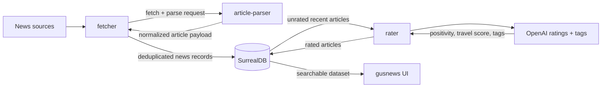

# News Scraper

[](https://github.com/mirsella/news-scraper/actions/workflows/rust.yml)
[](https://github.com/mirsella/news-scraper/actions/workflows/docker.yml)
[](https://www.rust-lang.org/tools/install)
[](https://doc.rust-lang.org/edition-guide/rust-2024/index.html)
[](https://surrealdb.com)
[](LICENSE)

A Rust workspace for collecting, normalizing, storing, and rating news articles at scale. It fetches thousands of articles from curated sources, parses the article content through a lightweight parser service, stores everything in SurrealDB, then uses OpenAI to score and tag each article for positivity, travel potential, and editorial discovery.

The browsing and search UI lives in [gusnews](https://github.com/mirsella/gusnews), a dedicated frontend for exploring this service's SurrealDB dataset with rich filters and search options.

## Pipeline



## Workspace

| Crate | Purpose |
| --- | --- |
| `fetcher` | Runs source adapters, fetches article pages, deduplicates URLs, cleans article bodies, and writes `news` records. |
| `rater` | Continuously rates unrated recent articles with OpenAI and stores positivity, travel, and tag metadata. |
| `shared` | Shared config, database model, sanitization helpers, Telegram notifications, and rating logic. |
| `bun-article-parser` | Local article parsing service used by `fetcher` through `ARTICLE_PARSER_URL`. |

## Features

- Parallel scraping across dozens of French, Belgian, Quebec, Africa, and travel/lifestyle sources.
- Per-source selection with `fetcher --enable source-a,source-b`.
- URL deduplication with tag merging when multiple providers discover the same article.
- HTML sanitization and text extraction before persistence.
- Scheduled Docker runtime for repeated fetches during the day.
- OpenAI-powered structured ratings using `gpt-5-nano` and JSON schema output.
- SurrealDB schema for authenticated UI access, article metadata, ratings, notes, and tags.
- Optional Telegram alerts for fetcher/rater failures.

## Requirements

- Rust stable, edition 2024.
- Docker and Docker Compose for the full stack.
- A SurrealDB instance, or the included Compose service.
- An OpenAI API key for `rater`.
- Chromium when running `fetcher` outside Docker.

CI builds and tests the workspace on Rust stable with `cargo build --verbose` and `cargo test --verbose`.

## Quick Start

```bash
git clone git@github.com:mirsella/news-scraper.git
cd news-scraper
cp .env.example .env
docker compose up --build
```

The Compose stack starts:

- `surrealdb` on `127.0.0.1:8000`
- `article_parser` on `127.0.0.1:8081`
- `fetcher`, scheduled by cron in the container
- `rater`, running continuously

## Configuration

Create `.env` from `.env.example` and fill the required values:

| Variable | Description |
| --- | --- |
| `DB_USER` | SurrealDB root username. |
| `DB_PASSWORD` | SurrealDB root password. |
| `ARTICLE_PARSER_URL` | URL of the article parser service. Compose uses `http://article_parser:8081`. |
| `SURREALDB_HOST` | SurrealDB HTTP host, for example `127.0.0.1:8000`. |
| `OPENAI_API_KEY` | OpenAI API key used by `rater`. |
| `RATING_CHAT_PROMPT` | Rating prompt override value kept in env compatibility; the binary currently embeds `rating-prompt.md`. |
| `PARALLEL_RATING` | Maximum number of concurrent OpenAI rating tasks. |
| `TELEGRAM_TOKEN` | Telegram bot token for alerts. |
| `TELEGRAM_ID` | Telegram chat id for alerts. |
| `NO_TELEGRAM` | Set to any value to disable sending Telegram messages at runtime. |
| `CHROME_HEADLESS` | Optional `fetcher` Chrome headless mode. |
| `CHROME_CONCURRENT` | Optional number of concurrent Chrome-backed fetch tasks. |
| `CHROME_DATA_DIR` | Optional Chrome profile/data directory. |

## Running Locally

Build and test everything:

```bash
cargo build
cargo test
```

List available source adapters:

```bash
cargo run -p fetcher -- --list
```

Run the fetcher against selected sources:

```bash
cargo run -p fetcher -- --enable fr::positivr,fr::goodnewsnetwork --ignore-empty-db
```

Run the rater:

```bash
cargo run -p rater
```

The fetcher reads `.env` by default. Use `--env-file path/to/file` if you need another configuration file.

## Database

The SurrealDB schema is defined in [`schema.surql`](schema.surql). The primary table is `news`, with fields for:

- article title, link, provider, date, caption, HTML body, and extracted text
- `rating`, a 0-100 positivity score
- `rating_travel`, a 0-100 travel/extraordinary-story score
- tags, notes, and `used` state

`gusnews` consumes this dataset directly and provides the human-facing UI for filtering, searching, and selecting articles.

## Docker Images

The multi-stage [`cargo.dockerfile`](cargo.dockerfile) builds the Rust workspace with musl and produces two runtime targets:

- `fetcher`, based on Alpine with Chromium and cron
- `rater`, based on Alpine with CA certificates and timezone data

The fetcher container is scheduled at `07:00`, `09:00`, `13:00`, `16:00`, and `18:00` Europe/Paris time.

## Frontend

[gusnews](https://github.com/mirsella/gusnews) is the companion UI frontend for this service. Use it to browse the SurrealDB news database, combine search filters, inspect ratings/tags, and work with the articles collected by this scraper.

## License

This project is licensed under the [MIT License](LICENSE).
